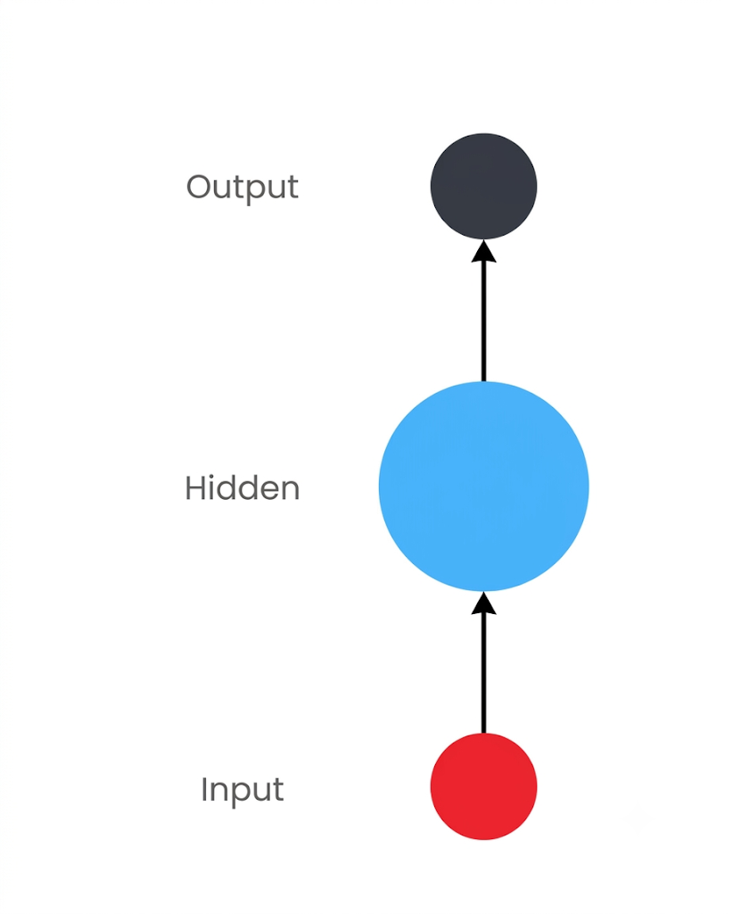

[深度学习](深度学习.md)
**学习目标**
- 了解什么是自然语言处理.
- 了解自然语言处理的发展简史.
- 了解自然语言处理的应用场景.
- 了解本教程中的自然语言处理**.**

**什么是自然语言处理?**
- 自然语言处理（Natural Language Processing，简称NLP）是计算机科学与语言学中关注于计算机与人类语言间转换的领域。

# 1  分词
- 分词就是将连续的字序列按照一定的规范重新组合成词序列的过程。我们知道，在英文的行文中，单词之间是以空格作为自然分界符的，而中文只是字、句和段能通过明显的分界符来简单划界，唯独词没有一个形式上的分界符，分词过程就是找到这样分界符的过程。
    
- 举个例子：  
    无线电法国别研究
	
	['无线电法', '国别', '研究']

- 分词的作用：
    - 词作为语言语义理解的最小单元，是人类理解文本语言的基础. 因此也是AI解决NLP领域高阶任务，如自动问答，机器翻译，文本生成的重要基础环节。
- 流行中文分词工具jieba:
    - 愿景: "结巴"中文分词, 做最好的 Python 中文分词组件.
- jieba的特性:
    - 支持多种分词模式
        - 精确模式
        - 全模式
        - 搜索引擎模式
		- 支持中文繁体分词
		- 支持用户自定义词典
- jieba的安装：
```python
pip install jieba
```
- jieba的使用：
    - 精确模式分词：
    - 试图将句子最精确地切开，适合文本分析.
```python
import jieba.posseg as pseg

# content = "无线电法国别研究"
# print(jieba.cut(content, cut_all=False)) # cut_all默认为False
  
# 若需直接返回列表内容，使用jieba.lcut即可
# print(jieba.lcut(content, cut_all=False))

# 若需直接返回列表内容，使用jieba.lcut即可
# print(jieba.lcut(content, cut_all=True))

# print(jieba.lcut(content))

# print(jieba.lcut_for_search(content))

# 若需直接返回列表内容，使用jieba.lcut_for_search即可
# print(jieba.lcut_for_search(content))

# content = "煩惱即是菩提，我暫且不提"
# print(jieba.lcut(content, cut_all=True))

# print(jieba.lcut("念念相续，不离般若"))

# print(jieba.lcut("我一把把车把把住了"))

# print(jieba.lcut("八一双鹿更名为八一南昌 篮球队！"))

# jieba.load_userdict("data/userdict.txt")

# print(jieba.lcut("八一双鹿更名为八一南昌篮球队，小猪老师去看了比赛！"))

print(pseg.lcut("我爱北京天安门，天安门上太阳升"))
```

# 2  文本张量的表示
 
- 了解什么是文本张量表示及其作用.
- 掌握文本张量表示的几种方法及其实现.

- 将一段文本使用张量进行表示，其中一般将词汇表示为向量，称作词向量，再由各个词向量按顺序组成矩阵形成文本表示.
    
- 举个例子：  
```txt
["人生", "该", "如何", "起头"]

==>

# 每个词对应矩阵中的一个向量
[[1.32, 4.32, 0.32, 5.2],  
[3.1, 5.43, 0.34, 3.2],  
[3.21, 5.32, 2, 4.32],  
[2.54, 7.32, 5.12, 9.54]]
```


- 文本张量表示的作用：
    - 将文本表示成张量（矩阵）形式，能够使语言文本可以作为计算机处理程序的输入，进行接下来一系列的解析工作.

- 文本张量表示的方法：
	- one-hot 编码
	- Word2vec
	- Word Embedding

## 2.2 one-hot 词向量表示
- 又称独热编码，将每个词表示成具有n个元素的向量，这个词向量中只有一个元素是1，其他元素都是0，不同词汇元素为0的位置不同，其中n的大小是整个语料中不同词汇的总数。
```txt
- 举个例子：  
["我", "爱", "北京", "天安门"]  
==>

[[1, 0, 0, 0],  
[0, 1, 0, 0],  
[0, 0, 1, 0],  
[0, 0, 0, 1]]
```

- one-hot编码的优劣势：
    - 优势：操作简单，容易理解。
    - 劣势：完全割裂了词与词之间的联系，而且在大语料集下，每个向量的长度过大，占据大量内存。
    - 正因为one-hot编码明显的劣势，这种编码方式被应用的地方越来越少，取而代之的是接下来我们要学习的稠密向量的表示方法 Word2Vec 和 Word Embedding。
	
## 2.3  Word2Vec 模型

 模型介绍：
- Word2Vec是一种流行的将词汇表示成向量的无监督训练方法，该过程将构建神经网络模型，将网络参数作为词汇的向量表示，它包含CBOW和skipgram两种训练模式。
### 2.3.1  CBOW(Continuous bag of words)模式
- 给定一段用于训练的文本语料，再选定某段长度(窗口)作为研究对象，使用上下文词汇预测目标词汇。

- 图中窗口大小为 9，使用前后 4 个词汇对目标词汇进行预测。

- CBOW模式下的Word2Vec过程说明:
    - 假设我们给定的训练语料只有一句话: Hope can set you free (愿你自由成长)，窗口大小为3，因此模型的第一个训练样本来自 Hope can set，因为是CBOW模式，所以将使用 Hope 和 set 作为输入，can 作为输出，在模型训练时，Hope，can，set等词汇都使用它们的 one-hot 编码。如图所示: 每个 one-hot 编码的单词与各自的变换矩阵（即参数矩阵 3x5，这里的 3 是指最后得到的词向量维度）相乘之后再相加，得到上下文表示矩阵(3 x 1)。

- 接着，将上下文表示矩阵与变换矩阵(参数矩阵 5x3，所有的变换矩阵共享参数)相乘，得到 5x1 的结果矩阵，它将与我们真正的目标矩阵即can的one-hot编码矩阵 (5 x 1) 进行损失的计算，然后更新网络参数完成一次模型迭代。


- 最后窗口按序向后移动，重新更新参数，直到所有语料被遍历完成，得到最终的变换矩阵 (3 x 5)，这个变换矩阵与每个词汇的 one-hot 编码 (5 x 1) 相乘，得到的 3x1 的矩阵就是该词汇的 Word2Vec 张量表示。

>[!Note] >注意1：如果整个模型训练结束了，哪一部分是我们真的需要的模型？
>- 只有左侧的矩阵 $W$ 是真正的 Word2Vec 模型 + 中间的词向量也是需要保存下来的
>- 右侧的矩阵 $W'$ 只是在训练时有用，训练结束后直接抛弃。

### 2.3.2  skipgram模式
- 假设我们给定的训练语料只有一句话: Hope can set you free (愿你自由成长)，窗口大小为 3，因此模型的第一个训练样本来自 Hope can set，因为是 skipgram 模式，所以将使用 can 作为输入，Hope 和 set 作为输出，在模型训练时，Hope，can，set等词汇都使用它们的 one-hot 编码。如图所示: 将 can 的 one-hot 编码与变换矩阵(即参数矩阵 3x5，这里的3是指最后得到的词向量维度)相乘，得到目标词汇表示矩阵 (3 x 1)。
    
- 接着，将目标词汇表示矩阵与多个变换矩阵(参数矩阵5 x 3)相乘，得到多个 5x1 的结果矩阵，它将与我们 Hope 和 set 对应的 one-hot 编码矩阵 (5 x 1) 进行损失的计算，然后更新网络参数完成一次模型迭代。

- 最后窗口按序向后移动，重新更新参数，直到所有语料被遍历完成，得到最终的变换矩阵即参数矩阵 (3 x 5)，这个变换矩阵与每个词汇的 one-hot 编码 (5 x 1) 相乘，得到的 3x1 的矩阵就是该词汇的 word2vec 张量表示。
### 2.3.3  Word2Vec 的训练和使用
1. 获取训练数据
2. 训练词向量
3. 模型超参数设定
4. 模型效果检验
5. 模型的保存与重加载

#### 2.3.3.1  获取训练数据
- 数据来源：[http://mattmahoney.net/dc/enwik9.zip](http://mattmahoney.net/dc/enwik9.zip)
	- 在这里，我们将研究英语维基百科的部分网页信息，它的大小在300M左右。这些语料已经被准备好，我们可以通过Matt Mahoney的网站下载
	
- 使用wikifil.pl文件处理脚本来清除XML/HTML格式的内容
	- 原始数据将输出很多包含XML/HTML格式的内容，这些内容并不是我们需要的
	- perl wikifil.pl data/enwik9 > data/fil9 

```python
# 代码运行在python解释器中
# 导入fasttext
>>> import fasttext
# 使用fasttext的train_unsupervised(无监督训练方法)进行词向量的训练
# 它的参数是数据集的持久化文件路径'data/fil9'
# 注意，该行代码执行耗时很长
>>> model1 = fasttext.train_unsupervised('data/fil9, thread=<cpu的最大核心数>')
# 可以使用以下代码加载已经训练好的模型
>>> model = fasttext.load_model("data/fil9.bin")
```

>[!NOTE]
>**注意：原始数据集 enwik9.zip，解压后数据为 enwik9，预处理后的数据为 fil9**
>- 2016 年 Facebook(Meta) 发布 fasttext --- 简单强大的工具，将进行快速文本分类

>[!Question]
>为什么训练 Word2Vec 的函数是 train_unsupervised() 无监督训练呢？
>1. 神经网络的训练必须要有一个标签（target value -- 目标值）
>2. 有了标签，才能计算损失 loss = output - target
>3. 才能进行反向传播 loss.backward()
>4. 才能进行参数更新 optimizer.step()
>5. 收敛后，模型训练完毕
>- 1 + 2 + 3 + 4 + 5 == 神经网络的训练能不能无标签？
>	- 不能！！！
>	- 所有基于 Hinton 反向传播算法来训练的神经网络大模型，2026年所有的大模型，背后都必须有标签。
>	- 当年 Google 招人标注了吗？ --- 没有  
>	- 2016 年 Facebook 这个 fasttext 工具标注了吗？ --- 没有
>- 所谓的 unsupervised 仅仅是因为不需要人类标注，就定义成无监督学习，但是背后的标注是靠代码自动化完成的!!!    
>- 总结: **Word2Vec 相当于在一个无监督的数据集下构造出一个有监督的训练任务!!!**

## 2.4 Word Embedding

- 通过一定的方式将词汇映射到指定维度(一般是更高维度)的空间.
- 广义的 word embedding 包括所有密集词汇向量的表示方法，如之前学习的 word2vec ，即可认为是 word embedding 的一种.
- 狭义的 word embedding 是指在神经网络中加入的 embedding 层，对整个网络进行训练的同时产生的 embedding 矩阵 (embedding 层的参数) ，这个 embedding 矩阵就是训练过程中所有输入词汇的向量表示组成的矩阵.

# 3  RNN 模型
- RNN(Recurrent Neural Network)，中文称作循环神经网络，它一般以序列数据为输入，通过网络内部的结构设计有效捕捉序列之间的关系特征，一般也是以序列形式进行输出。


- 一般单层神经网络结构：


- RNN单层网络结构：


- 以时间步对RNN进行展开后的单层网络结构：


- RNN的循环机制使模型隐层上一时间步产生的结果，能够作为当下时间步输入的一部分（当下时间步的输入除了正常的输入外还包括上一步的隐层输出）对当下时间步的输出产生影响。

## 3.1  RNN 模型的作用

- 因为RNN结构能够很好利用序列之间的关系，因此针对自然界具有连续性的输入序列，如人类的语言，语音等进行很好的处理，广泛应用于NLP领域的各项任务，如文本分类，情感分析，意图识别，机器翻译等.
    
- 下面我们将以一个用户意图识别的例子进行简单的分析:
	1. 用户输入了"What time is it?"，我们首先需要对它进行基本的分词，因为RNN是按照顺序工作的，每次只接收一个单词进行处理；
	2. 首先将单词"What"输送给 RNN，它将产生一个输出 O1；
	3. 继续将单词"time"输送给 RNN，但此时RNN不仅仅利用 "time" 来产生输出 O2，还会使用来自上一层隐层输出O1作为输入信息；
	4. 重复这样的步骤，直到处理完所有的单词；

	5. 最后，将最终的隐层输出O5进行处理来解析用户意图。


## 3.2  RNN 模型的分类
- 这里我们将从两个角度对 RNN 模型进行分类。第一个角度是输入和输出的结构，第二个角度是 RNN 的内部构造。
- 按照输入和输出的结构进行分类：
    - N vs N - RNN
    - N vs 1 - RNN
    - 1 vs N - RNN
    - N vs M - RNN

- 按照RNN的内部构造进行分类：
    - 传统 RNN
    - LSTM
    - Bi-LSTM
    - GRU
    - Bi-GRU
	
- N vs N - RNN:
    - 它是 RNN 最基础的结构形式，最大的特点就是：输入和输出序列是等长的。由于这个限制的存在，使其适用范围比较小，可用于生成等长度的合辙诗句。
		

- N vs 1 - RNN:
    - 有时候我们要处理的问题输入是一个序列，而要求输出是一个单独的值而不是序列，应该怎样建模呢？我们只要在最后一个隐层输出h上进行线性变换就可以了，大部分情况下，为了更好的明确结果，还要使用 sigmoid 或者 softmax 进行处理。这种结构经常被应用在文本分类问题上。
		

- 1 vs N - RNN:
    - 如果输入不是序列而输出为序列的情况怎么处理呢？我们最常采用的一种方式就是使该输入作用于每次的输出之上。这种结构可用于将图片生成文字任务等。
		

- N vs M - RNN:
    - 这是一种不限输入输出长度的 RNN 结构，它由编码器和解码器两部分组成，两者的内部结构都是某类 RNN，它也被称为 seq2seq 架构。输入数据首先通过编码器，最终输出一个隐含变量 c，之后最常用的做法是使用这个隐含变量 c 作用在解码器进行解码的每一步上，以保证输入信息被有效利用。
		

- seq2seq架构最早被提出应用于机器翻译，因为其输入输出不受限制，如今也是应用最广的RNN模型结构。在机器翻译，阅读理解，文本摘要等众多领域都进行了非常多的应用实践。
>[!Summary]
>- 学习了什么是RNN模型:
>	- RNN(Recurrent Neural Network), 中文称作循环神经网络，它一般以序列数据为输入，通过网络内部的结构设计有效捕捉序列之间的关系特征，一般也是以序列形式进行输出。
>- RNN的循环机制使模型隐层上一时间步产生的结果，能够作为当下时间步输入的一部分(当下时间步的输入除了正常的输入外还包括上一步的隐层输出)对当下时间步的输出产生影响。
>- 学习了RNN模型的作用:
>	- 因为RNN结构能够很好利用序列之间的关系，因此针对自然界具有连续性的输入序列，如人类的语言，语音等进行很好的处理，广泛应用于NLP领域的各项任务，如文本分类，情感分析，意图识别，机器翻译等。
>- 以一个用户意图识别的例子对RNN的运行过程进行简单的分析:
>	- 第一步: 用户输入了"What time is it?"，我们首先需要对它进行基本的分词，因为RNN是按照顺序工作的，每次只接收一个单词进行处理。

 ## 3.3  [[传统 RNN 的内部结构图]]

# 4  [[Transformer 模型]]
  
> [!QUESTION] 
>注意2：关于单词的张量表示？
>1. one-hot       --- 1980 ~ 2012 年
>2. Word2Vec  --- 2013 年 Google 提出
>3. Embedding --- 2017年

